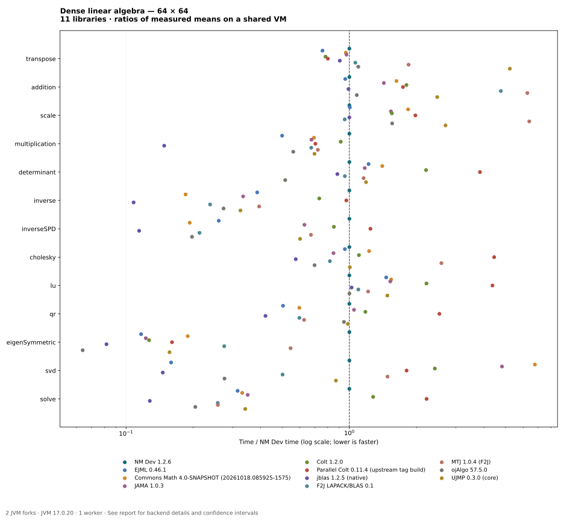
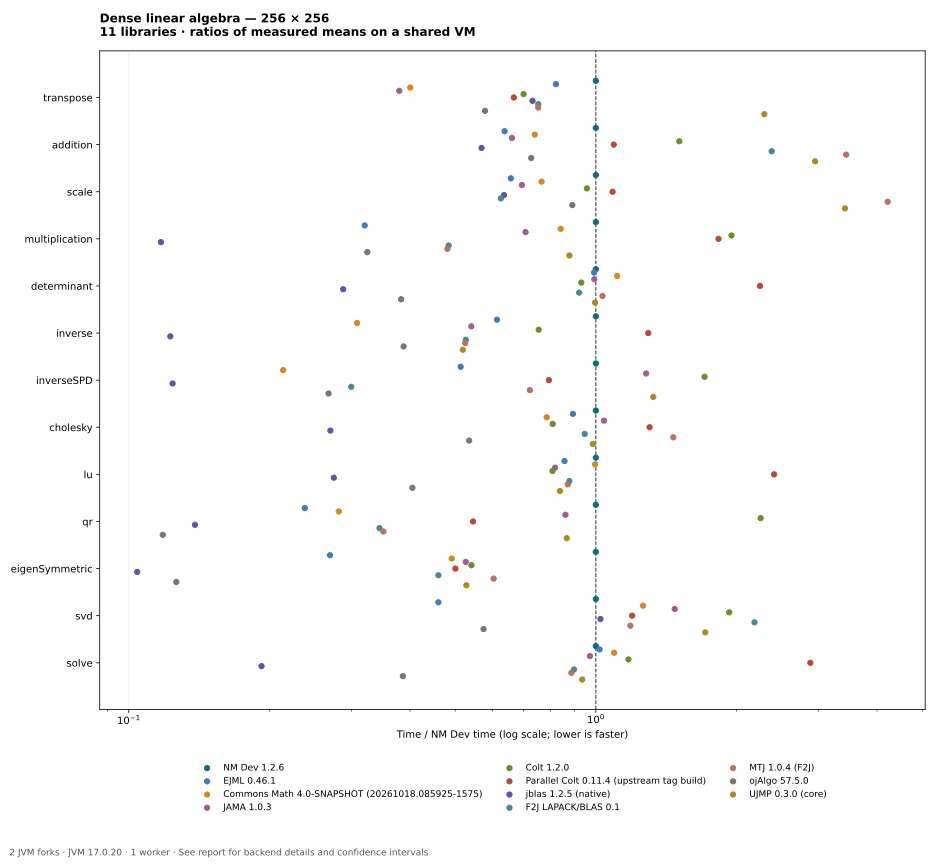

# Linear algebra benchmark results — 2026-10-18-latest

[Suite](../../README.md) · [Methodology](../../METHODOLOGY.md) · [Library coverage](../../LIBRARY-COVERAGE.md)

> Corrected harness: deferred ojAlgo results are materialized inside timing, native inputs are checked for mutation, and every fork validates repeat execution. These short iterations provide a diagnostic baseline; use longer runs on dedicated hardware for fine rankings. See the [fairness audit](../2026-10-18-fairness-audit/README.md).

**13 operations × 11 libraries × 2 sizes = 286 measured cases**, containing 1,716 measured iteration means. Lower milliseconds per operation is faster. These are observations on a shared VM, not universal performance rankings.

**[Interactive charts with tooltips](charts.html)** — download and open the self-contained HTML in a browser. Hover, tap or keyboard-focus a point for its version/backend, timing, confidence interval and ratio to NM Dev. GitHub inline image previews do not expose point tooltips. Standalone SVGs also contain native tooltip titles.

## Environment

AMD EPYC 9V74 80-Core Processor; Linux-6.18.55-x86_64-with-glibc2.39. Visible CPUs: 9; container CPU quota: `800000 100000`. JVM 17.0.20. No exclusive CPU reservation; any requested affinity is recorded below.

2 JVM forks per case; 2 warmup iterations of 200 ms; 3 measurement iterations of 200 ms. One JMH worker. The fork options fix a 1 GiB heap. Requested computational threads: 1; requested CPU affinity: 0. Affinity does not reserve a CPU exclusively.

Native thread environment variables request the recorded computational thread count. Parallel Colt, ojAlgo and UJMP also receive explicit library thread limits; MTJ uses an explicitly forced pure-Java F2J backend. Native jblas thread counts are not independently audited. See the environment and backend records below.

## Versions and backends

| Library | Measured version / backend |
| --- | --- |
| NMDEV | NM Dev 1.2.6 — Validated combined obfuscated 1.2.6 JAR; exact hash and CI source in validated-nmdev-artifact.json |
| EJML | EJML 0.46.1 — EJML 0.46.1 |
| COMMONS | Commons Math 4.0-SNAPSHOT (20261018.085925-1575) — Apache Commons Math4 legacy linear algebra; pinned official development snapshot 4.0-20261018.085925-1575 |
| JAMA | JAMA 1.0.3 — JAMA 1.0.3 |
| COLT | Colt 1.2.0 — Colt 1.2.0 |
| PARALLEL_COLT | Parallel Colt 0.11.4 (upstream tag build) — Upstream 0.11.4 release tag compiled without algorithm modifications; ConcurrencyUtils threads=1 |
| JBLAS | jblas 1.2.5 (native) — Bundled native libjblas; requested native environment threads=1; actual native worker counts not independently audited |
| F2J_LAPACK | F2J LAPACK/BLAS 0.1 — Direct translated Java BLAS/LAPACK distribution arpack_combined_all0.1; replacement distribution, not JLAPACK0.8 |
| MTJ | MTJ 1.0.4 (F2J) — F2jBLAS/F2jLAPACK/F2jARPACK explicitly forced by fork flags |
| OJALGO | ojAlgo 57.5.0 — R064Store/decomposition factories; library thread limit=1; deferred scalar results materialized inside timing |
| UJMP | UJMP 0.3.0 (core) — Core algorithms only; external backends disabled; threads=1 |

## Correctness and interpretation

All **429 baseline correctness cases passed twice**. Every measured fork also checks its selected result before timing. Reference arithmetic and residual checks are outside timing.

All **66 targeted row-swap/row-cycle cases** also passed. These check determinant signs, LU permutation orientation and solves on pivoting inputs.

Tables show **mean ± JMH 99.9% confidence half-width**, in ms/op. These error bars are not standard deviations. Overlapping intervals or high uncertainty make fine rankings unreliable. Chart ratios are ratios of means and do not show ratio uncertainty.

Native input conversion is outside timing; necessary copies, allocations and full factor output materialization are timed. This compares public API tasks, not identical algorithms. NM Dev Inverse detects symmetry and attempts Cholesky on SPD inputs, falling back to LU if that path raises a runtime exception. The exact measured JAR was verified separately by bytecode and runtime constructor-breakpoint tracing; see the fairness audit. F2J transpose/addition/scaling use adapter-owned Java loops because LAPACK does not define those matrix convenience APIs.

## 64 × 64 matrices

| Operation | NMDEV | EJML | COMMONS | JAMA | COLT | PARALLEL_COLT | JBLAS | F2J_LAPACK | MTJ | OJALGO | UJMP |
| --- | ---: | ---: | ---: | ---: | ---: | ---: | ---: | ---: | ---: | ---: | ---: |
| transpose | 0.0049969 ± 0.0027 | 0.0037877 ± 0.00049 | 0.0048181 ± 0.00033 | 0.0048515 ± 0.00055 | 0.0039089 ± 0.0012 | 0.0040052 ± 0.00081 | 0.0045269 ± 0.00047 | 0.0053157 ± 0.0011 | 0.0092013 ± 0.00023 | 0.0054774 ± 0.00037 | 0.026133 ± 0.0014 |
| addition | 0.0026649 ± 0.0004 | 0.0025546 ± 0.00059 | 0.0043319 ± 0.00056 | 0.0038018 ± 0.00086 | 0.0048006 ± 0.0015 | 0.0046299 ± 0.00052 | 0.0026406 ± 0.00047 | 0.012708 ± 0.0026 | 0.016702 ± 0.00093 | 0.0028769 ± 0.00036 | 0.0065925 ± 0.00018 |
| scale | 0.002261 ± 0.00025 | 0.0022725 ± 0.00016 | 0.0041443 ± 0.00056 | 0.0034708 ± 0.00087 | 0.0035058 ± 0.00056 | 0.0044676 ± 0.0017 | 0.0022613 ± 0.00036 | 0.0021555 ± 0.00017 | 0.014451 ± 0.0012 | 0.003515 ± 0.0006 | 0.0060943 ± 0.0029 |
| multiplication | 0.23289 ± 0.33 | 0.11645 ± 0.029 | 0.16178 ± 0.022 | 0.15752 ± 0.013 | 0.21307 ± 0.035 | 0.16411 ± 0.049 | 0.03451 ± 0.0015 | 0.1572 ± 0.017 | 0.16832 ± 0.0073 | 0.13059 ± 0.035 | 0.16248 ± 0.012 |
| determinant | 0.043506 ± 0.029 | 0.053017 ± 0.019 | 0.061098 ± 0.016 | 0.05098 ± 0.017 | 0.095894 ± 0.038 | 0.16728 ± 0.027 | 0.038451 ± 0.009 | 0.041536 ± 0.0087 | 0.050396 ± 0.0087 | 0.02246 ± 0.0014 | 0.051671 ± 0.011 |
| inverse | 0.61886 ± 0.6 | 0.23927 ± 0.014 | 0.11436 ± 0.031 | 0.20695 ± 0.036 | 0.45362 ± 0.63 | 0.59985 ± 0.62 | 0.066908 ± 0.011 | 0.1472 ± 0.039 | 0.24405 ± 0.031 | 0.16916 ± 0.097 | 0.20129 ± 0.042 |
| inverseSPD | 0.45822 ± 0.19 | 0.11917 ± 0.021 | 0.088304 ± 0.018 | 0.28834 ± 0.02 | 0.39078 ± 0.11 | 0.56926 ± 0.15 | 0.052438 ± 0.0047 | 0.097737 ± 0.0052 | 0.3084 ± 0.037 | 0.09046 ± 0.028 | 0.27572 ± 0.069 |
| cholesky | 0.034209 ± 0.011 | 0.032664 ± 0.0064 | 0.04192 ± 0.0074 | 0.029048 ± 0.00097 | 0.037755 ± 0.0045 | 0.15222 ± 0.016 | 0.01968 ± 0.00044 | 0.027985 ± 0.00089 | 0.088371 ± 0.04 | 0.023903 ± 0.00055 | 0.034387 ± 0.0083 |
| lu | 0.043119 ± 0.014 | 0.063024 ± 0.019 | 0.066356 ± 0.01 | 0.065742 ± 0.022 | 0.095492 ± 0.036 | 0.1886 ± 0.054 | 0.044123 ± 0.0066 | 0.047303 ± 0.0085 | 0.052307 ± 0.013 | 0.043144 ± 0.018 | 0.063829 ± 0.019 |
| qr | 0.35601 ± 0.27 | 0.1796 ± 0.037 | 0.2125 ± 0.034 | 0.37344 ± 0.14 | 0.42 ± 0.09 | 0.90087 ± 0.67 | 0.14991 ± 0.095 | 0.21266 ± 0.056 | 0.22318 ± 0.046 | 0.33671 ± 0.26 | 0.35055 ± 0.031 |
| eigenSymmetric | 5.0916 ± 1.7 | 0.59458 ± 0.11 | 0.96193 ± 0.98 | 0.62406 ± 0.084 | 0.64549 ± 0.061 | 0.81789 ± 0.84 | 0.41615 ± 0.02 | 1.4016 ± 1.9 | 2.777 ± 2.7 | 0.32563 ± 0.036 | 0.7974 ± 0.79 |
| svd | 7.3479 ± 8.2 | 1.1691 ± 0.22 | 49.761 ± 1.3e+02 | 35.454 ± 1.3e+02 | 17.736 ± 28 | 13.253 ± 6.8 | 1.0731 ± 0.079 | 3.6912 ± 0.5 | 10.893 ± 5.5 | 2.0278 ± 1.8 | 6.3974 ± 7.4 |
| solve | 0.19751 ± 0.21 | 0.062414 ± 0.034 | 0.065432 ± 0.015 | 0.069237 ± 0.028 | 0.25246 ± 0.37 | 0.43782 ± 0.58 | 0.025231 ± 0.0026 | 0.050872 ± 0.019 | 0.050904 ± 0.028 | 0.040367 ± 0.044 | 0.067532 ± 0.021 |

NM Dev is 1×. Below 1× means less time than NM Dev; above 1× means more time. Logarithmic scale. Use the interactive HTML for exact point details.

## 256 × 256 matrices

| Operation | NMDEV | EJML | COMMONS | JAMA | COLT | PARALLEL_COLT | JBLAS | F2J_LAPACK | MTJ | OJALGO | UJMP |
| --- | ---: | ---: | ---: | ---: | ---: | ---: | ---: | ---: | ---: | ---: | ---: |
| transpose | 0.22752 ± 0.071 | 0.18684 ± 0.025 | 0.091172 ± 0.0086 | 0.086321 ± 0.01 | 0.15934 ± 0.027 | 0.15185 ± 0.0093 | 0.16652 ± 0.012 | 0.17133 ± 0.085 | 0.17122 ± 0.021 | 0.13176 ± 0.023 | 0.5222 ± 0.014 |
| addition | 0.078467 ± 0.04 | 0.050052 ± 0.015 | 0.058084 ± 0.013 | 0.051887 ± 0.012 | 0.11841 ± 0.083 | 0.08571 ± 0.012 | 0.044675 ± 0.0067 | 0.18672 ± 0.087 | 0.26965 ± 0.017 | 0.057062 ± 0.026 | 0.23133 ± 0.028 |
| scale | 0.062967 ± 0.05 | 0.041409 ± 0.0059 | 0.048188 ± 0.0055 | 0.043734 ± 0.0066 | 0.060238 ± 0.011 | 0.068384 ± 0.0078 | 0.040034 ± 0.01 | 0.039423 ± 0.0089 | 0.26541 ± 0.021 | 0.056076 ± 0.03 | 0.21495 ± 0.018 |
| multiplication | 18.147 ± 1.1 | 5.8074 ± 0.81 | 15.257 ± 3.8 | 12.832 ± 1.3 | 35.42 ± 2.3 | 33.22 ± 2.9 | 2.1267 ± 0.099 | 8.7855 ± 0.28 | 8.7309 ± 0.29 | 5.8832 ± 0.84 | 15.933 ± 0.54 |
| determinant | 3.897 ± 3 | 3.8628 ± 0.23 | 4.3293 ± 0.66 | 3.8676 ± 0.5 | 3.6275 ± 1.1 | 8.754 ± 1.4 | 1.1214 ± 0.053 | 3.5893 ± 0.23 | 4.027 ± 0.81 | 1.4921 ± 0.35 | 3.8829 ± 0.44 |
| inverse | 23.677 ± 6.5 | 14.54 ± 3.8 | 7.2961 ± 0.65 | 12.813 ± 1.9 | 17.864 ± 8.2 | 30.659 ± 34 | 2.9067 ± 0.79 | 12.468 ± 3.7 | 12.435 ± 4.1 | 9.1774 ± 0.13 | 12.289 ± 0.85 |
| inverseSPD | 19.684 ± 7 | 10.107 ± 0.74 | 4.2142 ± 0.96 | 25.221 ± 2.9 | 33.637 ± 0.66 | 15.617 ± 3.4 | 2.4429 ± 0.32 | 5.8945 ± 0.92 | 14.219 ± 1.1 | 5.2714 ± 0.29 | 26.124 ± 0.93 |
| cholesky | 2.1024 ± 0.55 | 1.8778 ± 0.4 | 1.6499 ± 0.22 | 2.1882 ± 0.37 | 1.6997 ± 0.12 | 2.7405 ± 0.49 | 0.56816 ± 0.1 | 1.9902 ± 0.31 | 3.0793 ± 0.9 | 1.1261 ± 0.35 | 2.071 ± 0.55 |
| lu | 4.7155 ± 6.4 | 4.0409 ± 0.79 | 4.6993 ± 0.58 | 3.858 ± 0.39 | 3.8086 ± 0.54 | 11.355 ± 7.8 | 1.2959 ± 0.13 | 4.1396 ± 0.83 | 4.1047 ± 1.3 | 1.909 ± 0.31 | 3.9513 ± 0.92 |
| qr | 44.715 ± 70 | 10.651 ± 0.56 | 12.593 ± 1.6 | 38.494 ± 1.4 | 100.76 ± 3.3 | 24.409 ± 6 | 6.199 ± 1 | 15.391 ± 1 | 15.687 ± 1.4 | 5.2878 ± 1.1 | 38.744 ± 1.5 |
| eigenSymmetric | 93.719 ± 35 | 25.275 ± 0.33 | 46.059 ± 2.8 | 49.347 ± 8.1 | 50.752 ± 14 | 46.905 ± 1.2 | 9.7716 ± 1.3 | 43.125 ± 39 | 56.62 ± 22 | 11.849 ± 2 | 49.506 ± 5 |
| svd | 114.51 ± 42 | 52.69 ± 8 | 144.57 ± 7.7 | 168.98 ± 1.4e+02 | 220.99 ± 2.7e+02 | 136.91 ± 29 | 117.15 ± 16 | 250.34 ± 86 | 135.76 ± 43 | 65.836 ± 54 | 196.42 ± 2.4e+02 |
| solve | 4.2655 ± 2.9 | 4.3439 ± 0.46 | 4.6684 ± 1 | 4.1434 ± 0.95 | 5.0097 ± 5.1 | 12.282 ± 8.1 | 0.8208 ± 0.19 | 3.8312 ± 0.34 | 3.7813 ± 0.12 | 1.6474 ± 0.19 | 3.9884 ± 0.45 |

NM Dev is 1×. Below 1× means less time than NM Dev; above 1× means more time. Logarithmic scale. Use the interactive HTML for exact point details.

## Limits

No aggregate speedup is reported because averaging operation ratios imposes an arbitrary workload weighting. This run uses one deterministic family of well-conditioned square matrices. It does not measure sparse matrices, conic optimization, parallel scaling, very large inputs or stability on difficult problems. Parameter order is deterministic, and the VM is shared. Reproduce your own workload on dedicated hardware before making broad performance claims.

## Raw evidence

- [JMH JSON and per-fork iteration means](jmh.json)
- [Complete JMH log](jmh.log)
- [Summary CSV](summary.csv)
- [JVM allocation per operation; native allocations are not fully included](allocation.csv)
- [Baseline correctness residuals](correctness.csv)
- [Targeted pivot/sign checks](pivot-correctness.csv)
- [Environment and requested thread settings](environment.json)
- [Backend records](backends.json)
- [Artifact versions and SHA-256 checksums](artifacts.json)
- [Measured source checksums](source-checksums.json)
- [Dependency release metadata](dependency-metadata.json)
- [Exact harness source snapshot](harness-source.zip)
- [Deferred-output and mutation regression checks](fairness-check.txt)

Regenerate with `python3 benchmark/scripts/report.py benchmark/results/2026-10-18-latest`. Python only summarizes measurements and renders charts; all measured calculations run in Java/JMH. Matplotlib is required to regenerate charts and the self-contained HTML.
