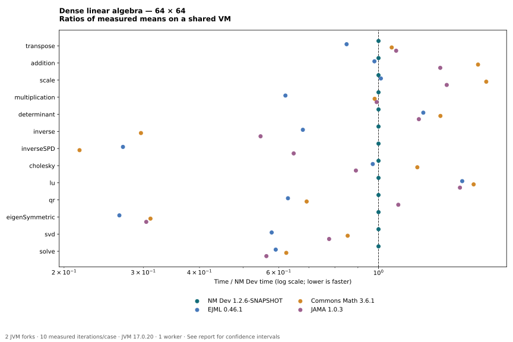
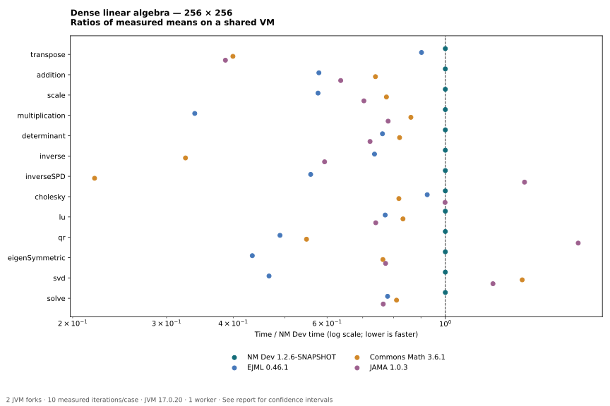

# Linear algebra benchmark results — 2026-10-18

[Suite and reproduction instructions](../../../README.md) · [Methodology](../../../METHODOLOGY.md)

**[Interactive charts with tooltips](charts.html)** — download and open the HTML file in a browser. Hover, tap or keyboard-focus a point for its timing, 99.9% confidence interval and ratio to NM Dev. GitHub inline image previews do not expose these tooltips; the standalone SVGs also include native tooltip titles.

Measured here: **13 operations × four libraries × two sizes = 104 cases**, with two JVM forks and ten measured iteration means per case. Lower milliseconds per operation is faster. These are observations on a shared virtual machine, not universal performance rankings.

## Environment

AMD EPYC 9V74 80-Core Processor; Linux-6.18.55-x86_64-with-glibc2.39. CPU quota: `800000 100000`; visible CPUs: 9. See the recorded environment files for JVM details. No exclusive CPU reservation or affinity pinning is claimed.

Three 300 ms warmup iterations and five 500 ms measurement iterations per fork; two forks. Matrices are deterministic, dense and well-conditioned. Native input construction is outside timing; result allocation, needed input copies and factor materialization are timed.

## Checks and interpretation

All 156 correctness cases (including size 4) passed twice. Each measured fork also validates its selected result before timing. See [correctness.csv](correctness.csv).

Tables show **mean ± JMH 99.9% confidence half-width**, in milliseconds per operation. This is not standard deviation. Very small differences or overlapping intervals should not be treated as established rankings. Normalized charts use ratios of means and do not display ratio uncertainty.

The adapters use different public APIs and sometimes different algorithms. Correction: NM Dev Inverse detects symmetry and attempts Cholesky for SPD inputs, with LU fallback on a runtime exception. The exact measured JAR was verified by bytecode and constructor-breakpoint tracing; see the [fairness audit](../fairness-audit/README.md). Consult the [methodology](../../../METHODOLOGY.md) and adapter source before interpreting any timing difference.

## 64 × 64 matrices

| Operation | NM Dev | EJML | Commons Math | JAMA |
|---|---:|---:|---:|---:|
| transpose | 0.0040259 ± 0.00024 | 0.0034194 ± 0.00024 | 0.0043073 ± 9.5e-05 | 0.0044058 ± 0.00022 |
| addition | 0.0025069 ± 0.00016 | 0.0024551 ± 0.0001 | 0.0041718 ± 0.00016 | 0.0034385 ± 0.00039 |
| scale | 0.0021805 ± 9.1e-05 | 0.0022069 ± 0.00013 | 0.0037845 ± 0.00027 | 0.0030916 ± 0.00019 |
| multiplication | 0.15579 ± 0.0082 | 0.096747 ± 0.0018 | 0.15274 ± 0.0063 | 0.15432 ± 0.0089 |
| determinant | 0.038887 ± 0.0037 | 0.048904 ± 0.00089 | 0.053384 ± 0.0019 | 0.047805 ± 0.0027 |
| inverse | 0.3396 ± 0.012 | 0.23057 ± 0.013 | 0.10068 ± 0.0067 | 0.1857 ± 0.0064 |
| inverseSPD | 0.39547 ± 0.022 | 0.10693 ± 0.0054 | 0.08562 ± 0.0036 | 0.2562 ± 0.016 |
| cholesky | 0.03318 ± 0.0018 | 0.032218 ± 0.0024 | 0.040471 ± 0.0024 | 0.029553 ± 0.0014 |
| lu | 0.038351 ± 0.0028 | 0.058857 ± 0.0041 | 0.062405 ± 0.0019 | 0.058182 ± 0.0028 |
| qr | 0.27011 ± 0.014 | 0.16992 ± 0.0097 | 0.18698 ± 0.0066 | 0.29888 ± 0.0073 |
| eigenSymmetric | 2.0471 ± 0.34 | 0.5434 ± 0.044 | 0.63719 ± 0.015 | 0.62361 ± 0.046 |
| svd | 1.8802 ± 0.11 | 1.0882 ± 0.09 | 1.6055 ± 0.062 | 1.4601 ± 0.039 |
| solve | 0.098729 ± 0.012 | 0.058339 ± 0.0026 | 0.061579 ± 0.0023 | 0.055621 ± 0.0018 |

The NM Dev reference is 1×. Below 1× means less time than NM Dev; above 1× means more time. Logarithmic scale. These are task-level API measurements on this input family.

## 256 × 256 matrices

| Operation | NM Dev | EJML | Commons Math | JAMA |
|---|---:|---:|---:|---:|
| transpose | 0.18789 ± 0.0065 | 0.16952 ± 0.0099 | 0.075077 ± 0.0037 | 0.072679 ± 0.0032 |
| addition | 0.067577 ± 0.033 | 0.039142 ± 0.0032 | 0.049972 ± 0.0021 | 0.043009 ± 0.0013 |
| scale | 0.056722 ± 0.0073 | 0.032733 ± 0.001 | 0.043982 ± 0.0019 | 0.039904 ± 0.0037 |
| multiplication | 16.288 ± 2.9 | 5.5193 ± 0.35 | 14.036 ± 0.53 | 12.723 ± 0.58 |
| determinant | 5.0857 ± 1.8 | 3.8765 ± 0.22 | 4.1739 ± 0.18 | 3.6741 ± 0.21 |
| inverse | 19.821 ± 2.6 | 14.598 ± 0.97 | 6.4533 ± 0.31 | 11.767 ± 1.1 |
| inverseSPD | 17.841 ± 2.4 | 9.9738 ± 0.41 | 3.9221 ± 0.12 | 25.117 ± 0.73 |
| cholesky | 1.9216 ± 0.13 | 1.7771 ± 0.031 | 1.5723 ± 0.084 | 1.9193 ± 0.19 |
| lu | 5.0601 ± 2.3 | 3.9026 ± 0.24 | 4.2142 ± 0.28 | 3.7465 ± 0.22 |
| qr | 21.399 ± 1.6 | 10.478 ± 0.91 | 11.749 ± 0.44 | 37.984 ± 0.82 |
| eigenSymmetric | 59.666 ± 9 | 25.922 ± 1.8 | 45.564 ± 2 | 46.094 ± 1.6 |
| svd | 107.28 ± 4 | 50.101 ± 0.69 | 149.53 ± 9 | 131.78 ± 4.6 |
| solve | 5.0301 ± 0.47 | 3.9197 ± 0.23 | 4.0744 ± 0.18 | 3.8473 ± 0.17 |

The NM Dev reference is 1×. Below 1× means less time than NM Dev; above 1× means more time. Logarithmic scale. These are task-level API measurements on this input family.

## Reading the results

No single aggregate speedup is reported: averaging operation ratios would impose an arbitrary workload weighting. Choose the operations and sizes relevant to your application, then reproduce them on your hardware. The small-size results are especially sensitive to allocation and dispatch overhead.

This run does not measure sparse matrices, conic optimization, native BLAS, large matrices, parallel scaling or numerical stability on difficult inputs. It does not compare the removed legacy adapters.

## Raw evidence

- [JMH JSON, including raw per-fork iterations and confidence intervals](jmh.json)
- [Complete JMH output](jmh.log)
- [Summary CSV](summary.csv)
- [Correctness residuals](correctness.csv)
- [Environment](environment.json)
- [Artifact versions and SHA-256 checksums](artifacts.json)
- [Measured source checksums](source-checksums.json)

Regenerate the summary with `python3 benchmark/scripts/report.py benchmark/results/2026-10-18/original` from the repository root. Python is used only for reporting; every measured operation runs in Java under JMH. Matplotlib is optional for regenerating the SVG charts.
